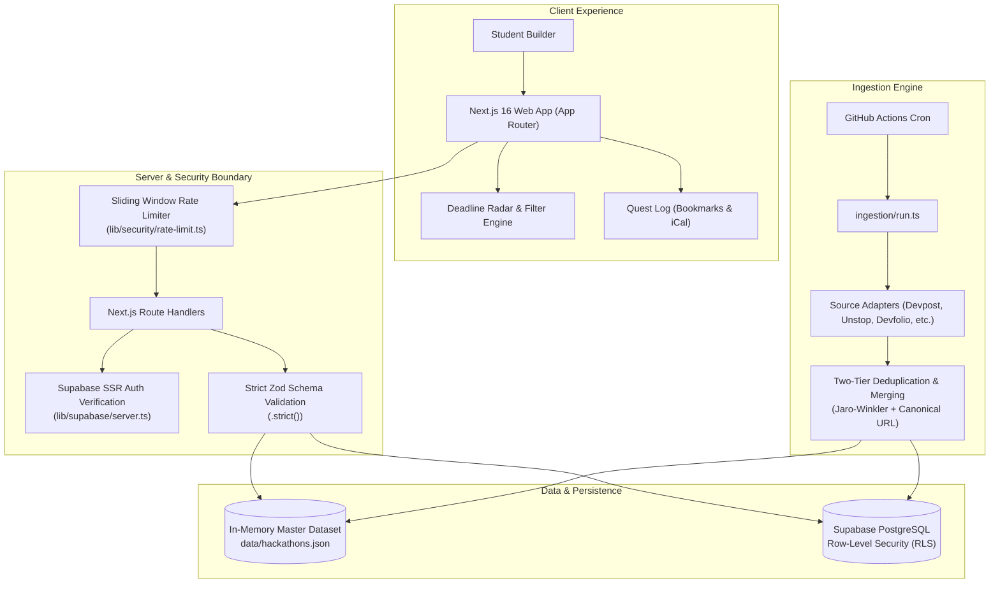

<div align="center">

# ⚡ BuildSeek
### Every Hackathon. One Place. Never Miss a Deadline.

[](https://nextjs.org/)
[](https://react.dev/)
[](https://www.typescriptlang.org/)
[](https://supabase.com/)
[](https://tailwindcss.com/)
[](https://vitest.dev/)
[](LICENSE)

<br />

**SideQuest** aggregates developer sprints, college hackathons, and global open-innovation challenges from Devfolio, Unstop, Devpost, Hack2skill, and community boards into a single, high-contrast, zero-fluff dashboard with live countdown radars, personalized match scoring, and calendar sync.

[**Explore Live App**](https://sidequesttt.vercel.app) • [**Report Vulnerability**](#-security--hardening) • [**Ingestion Pipeline**](#-multi-source-ingestion-pipeline) • [**Contributing**](#-contributing)

</div>

---

## 🌟 Key Highlights

- ⏱️ **Deadline Radar**: Live countdown clocks and dynamic urgency states (`closing_soon`, `open`, `upcoming`, `closed`). Never miss a registration window again.
- 🎯 **Match Scoring Engine**: Calculates relevance score (0–100%) based on your technical skills, graduation year, team size, and geographical proximity.
- 📅 **One-Click iCal & Google Calendar Sync**: Live subscription feeds (`/api/calendar/[token]`) that automatically sync deadlines to your Apple or Google Calendar.
- 🤖 **Telegram Alert Integration**: Direct notifications via `@SideQuestAlertsBot` with timing-safe cryptographically signed webhooks.
- 🔍 **Multi-Source Aggregation**: Automated scraping and normalization across Devpost, Devfolio, Unstop, and college hackathon portals.
- 🛡️ **Hardened for Production**: Zero-trust BOLA defenses, Row-Level Security (RLS) across all tables, sliding-window rate limiting, and strict Zod runtime schema validation.
- 🎨 **Neo-Brutalist Visual Identity**: High-contrast, tactile parchment & ink styling tailored for high readability and lightning-fast loading speeds on mobile networks.

---

## 🏗️ Architecture & Technical Design

SideQuest combines an **in-memory edge dataset** for sub-10ms query execution with an **event-driven Supabase PostgreSQL mirror** for persistent bookmarks, user profiles, and alert rules.



---

## 🛡️ Security & Hardening Guarantees

SideQuest is hardened according to enterprise security standards:

| Security Vector | Implementation Detail | Primary Module |
| :--- | :--- | :--- |
| **BOLA Defense** | All user mutations strictly bind to server-verified sessions (`getAuthenticatedUser`); client-supplied user IDs are rejected. | [`lib/supabase/server.ts`](lib/supabase/server.ts) |
| **Row-Level Security** | Restrictive PostgreSQL policies for all 7 tables; public write access strictly denied. | [`supabase/migrations/`](supabase/migrations/) |
| **Rate Limiting** | In-memory sliding window limiter with IP discovery (`cf-connecting-ip`, `x-forwarded-for`) and RFC `429` headers. | [`lib/security/rate-limit.ts`](lib/security/rate-limit.ts) |
| **Input Validation** | All API routes enforce `.strict()` Zod schemas, disallowing unrecognized properties and malicious prototype injections. | [`app/api/`](app/api/) |
| **Webhook Cryptography** | Constant-time token verification (`crypto.timingSafeEqual`) preventing timing attacks on third-party webhook feeds. | [`lib/security/webhook.ts`](lib/security/webhook.ts) |
| **Log Sanitization** | Internal error messages and driver exceptions are redacted before returning HTTP responses. | [`app/api/health/route.ts`](app/api/health/route.ts) |

---

## 🚀 Quick Start & Installation

### Prerequisites
- **Node.js**: `v20.x` or higher (LTS recommended)
- **npm**: `v10.x` or higher

### 1. Clone the Repository
```bash
git clone https://github.com/your-username/sidequest.git
cd sidequest
```

### 2. Install Dependencies
```bash
npm install
```

### 3. Configure Environment Variables
Copy the template and configure your local settings:
```bash
cp .env.example .env.local
```

| Variable | Description | Required |
| :--- | :--- | :--- |
| `NEXT_PUBLIC_SUPABASE_URL` | Supabase Project URL | Optional (falls back to local data) |
| `NEXT_PUBLIC_SUPABASE_ANON_KEY` | Supabase Anon Public API Key | Optional |
| `SUPABASE_SERVICE_ROLE_KEY` | Supabase Service Role Key for ingestion | Ingestion only |
| `TELEGRAM_WEBHOOK_SECRET` | Secret token for Telegram Bot Webhook | Production bot only |
| `CALENDAR_TOKEN_SALT` | 32-character salt string for calendar token hashing | Production only |
| `NEXT_PUBLIC_APP_URL` | Base canonical application URL | Recommended |
| `NEXT_PUBLIC_GOOGLE_SITE_VERIFICATION` | Google Search Console verification token | Production SEO |

### 4. Run Development Server
```bash
npm run dev
```
Open [http://localhost:3000](http://localhost:3000) in your browser.

---

## 🧪 Testing Suite

SideQuest includes comprehensive unit, integration, and security tests powered by **Vitest**:

```bash
# Run all tests once
npm test

# Run tests in watch mode
npm run test:watch
```

Test coverage includes:
- **Security & Rate Limiting**: Verification of rate limit thresholds, BOLA protection, and `.strict()` Zod schemas.
- **Query & Filter Engine**: Accuracy tests for geographic, prize, mode, and `closing_soon` filters.
- **Ingestion & Deduplication**: Canonical URL normalization, duplicate candidate scoring, and adapter resilience.
- **Calendar Generation**: RFC 5545 compliance and timezone format verification.

---

## 🤖 Multi-Source Ingestion Pipeline

SideQuest runs an automated ingestion pipeline to discover new hackathons:

```bash
# Dry run: fetch and normalize without writing to disk or database
npm run ingest:dry

# Production run: fetch, deduplicate, write to data/hackathons.json and Supabase
npm run ingest
```

### Supported Source Adapters
- `Curated`: Hand-verified premium Indian & global hackathons with rich track descriptions.
- `Devpost`: Web scraping & challenge feeds from international corporate & community hackathons.
- `Devfolio`: Web3, blockchain, and university tech sprints across India.
- `Unstop`: Pan-India collegiate innovation challenges, SPOC nominations, and case competitions.
- `Hack2skill`: National technology hackathons and student developer sprints.

---

## 📁 Repository Structure

```text
├── app/                       # Next.js App Router pages and API routes
│   ├── api/                   # Hardened route handlers (submit, bookmarks, calendar, webhook)
│   ├── discover/              # Real-time search, filters, and cards
│   ├── quest-log/             # Bookmarks, deadline radar, and iCal feed
│   ├── profile/               # User skills, year, and alert rules
│   └── layout.tsx             # Root layout with responsive bottom navigation
├── components/                # Modular React components
│   ├── discover/              # Filter sheet, desktop sidebar, and empty states
│   ├── hackathon/             # Hackathon cards and deadline countdown badges
│   ├── sidequest/             # Neo-brutalist primitives and mascot ("Sidey")
│   └── ui/                    # Accessible dialogs, buttons, and badges
├── data/                      # Master dataset (hackathons.json)
├── ingestion/                 # Multi-platform scrapers, normalizers, and deduplication
├── lib/                       # Core domain logic
│   ├── db/                    # Query engine and database access layer
│   ├── security/              # Rate limiting and cryptographic webhook verification
│   ├── supabase/              # Browser and secure server-side client helpers
│   ├── filters.ts             # Filter predicates and tag categorization
│   └── ics.ts                 # RFC 5545 iCalendar feed generator
├── public/                    # PWA manifests, icons, and static assets
├── seed/                      # Verified static hackathon seeds
├── supabase/migrations/       # Row-Level Security and database schema migrations
└── tests/                     # Vitest test suites (database, security, ingestion, filters)
```

---

## 📄 License & Community

Distributed under the **MIT License**. Built with ❤️ for student hackers, builders, and nocturnal software creators.
