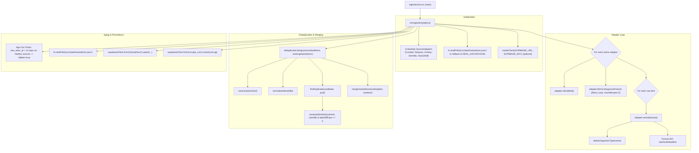
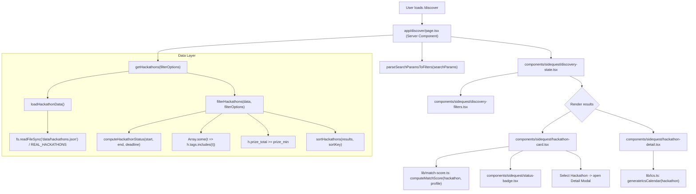
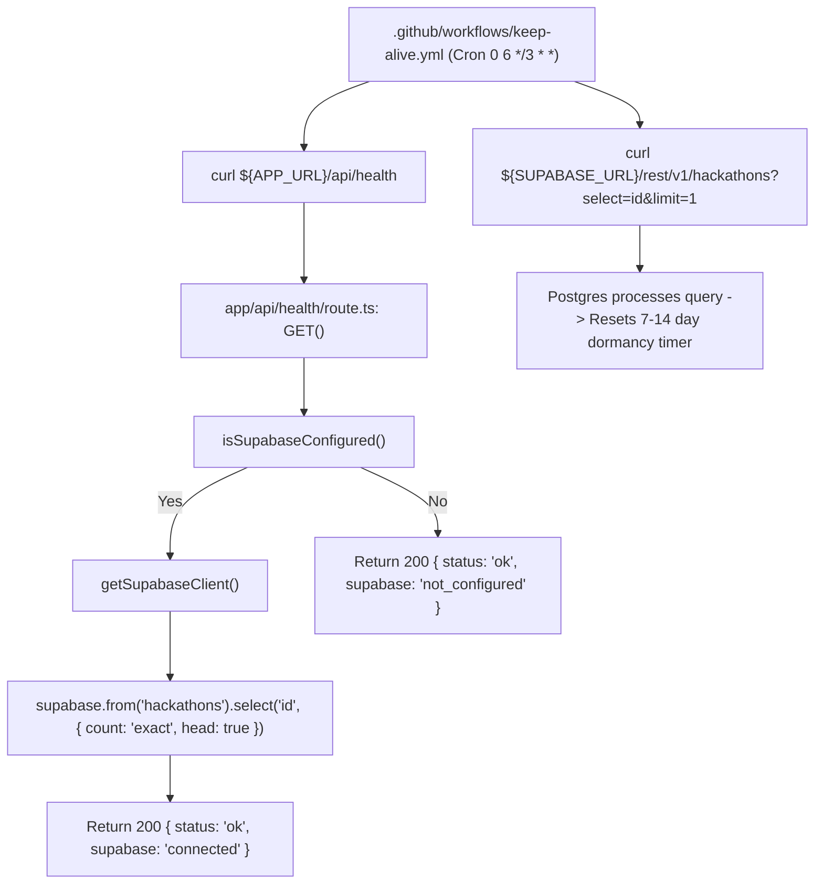

# System Execution Flow & Call Graph

This document details the exact execution paths, entry points, sequence of operations, and cross-module function call graphs for BuildSeek.

---

## 1. Ingestion Pipeline Execution Flow

### Entry Point
- CLI: `npx tsx ingestion/run.ts [--fixture] [--dry-run]`
- CI/CD: `.github/workflows/ingest.yml` (triggered via daily cron or manual dispatch)

### Execution Sequence & Call Hierarchy

### Function Mapping Reference
| Module | Function | Called By | Calls | Purpose |
| :--- | :--- | :--- | :--- | :--- |
| `ingestion/run.ts` | `runIngestion` | CLI / GitHub Actions | `adapter.fetchListings`, `adapter.normalize`, `deduplicateListings`, `mergeHackathons` | Orchestrates batch scraping and sync |
| `ingestion/adapters/types.ts` | `detectOrganizerType` | Adapters (`normalize`) | Regex pattern matching | Categorizes organizer into 6 standardized types |
| `ingestion/dedupe.ts` | `deduplicateListings` | `runIngestion` | `findDuplicate`, `canonicalizeUrl`, `normalizeName` | Identifies duplicate listings across sources |
| `ingestion/dedupe.ts` | `canonicalizeUrl` | `deduplicateListings`, `findDuplicate` | `URL` parsing, param stripping | Strips tracking queries and trailing slashes |
| `ingestion/dedupe.ts` | `mergeHackathons` | `runIngestion`, `deduplicateListings` | Object spread & preference logic | Combines two matching records preserving best fields |

---

## 2. Discovery UI Page & Interaction Loop

### Entry Point
- Browser route: `/discover` (`app/discover/page.tsx`)

### Execution Sequence & Call Hierarchy

### Function Mapping Reference
| Module | Function | Called By | Calls | Purpose |
| :--- | :--- | :--- | :--- | :--- |
| `app/discover/page.tsx` | `DiscoverPage` | Next.js Router | `parseSearchParamsToFilters`, `getHackathons` | Server renders initial hackathon discovery catalog |
| `lib/filters.ts` | `parseSearchParamsToFilters` | `DiscoverPage`, API handlers | `searchParams` parsing | Converts URL search parameters into strongly-typed `HackathonFilterOptions` |
| `lib/db/hackathons.ts` | `getHackathons` | `DiscoverPage` | `loadHackathonData`, `filterHackathons`, `sortHackathons` | Queries dataset with pagination, filters, and sort orders |
| `lib/match-score.ts` | `computeMatchScore` | `HackathonCard`, `HackathonDetail` | Scoring weight rules | Computes 0-100% personalized relevance score |
| `lib/ics.ts` | `generateIcsCalendar` | `HackathonDetail` | Date formatters, ICS string builder | Generates RFC 5545 `.ics` event file for 1-click calendar sync |

---

## 3. ICS Calendar Export Flow

### Entry Point
- User clicks "Add to Calendar (.ics)" button in `components/sidequest/hackathon-detail.tsx`.

### Sequence & Execution
1. `HackathonDetail` invokes `generateIcsCalendar(hackathon)`.
2. `lib/ics.ts` parses `registration_deadline`, `start_date`, and `end_date`.
3. Creates two distinct VEVENT calendar blocks:
   - **Deadline Alert Event**: Triggered on `registration_deadline` with alarm reminder.
   - **Hackathon Run Event**: Spanning `start_date` to `end_date` with event description, venue/URL, and rules.
4. Generates an RFC 5545 compliant string payload (`BEGIN:VCALENDAR...END:VCALENDAR`).
5. `HackathonDetail` creates an in-memory `Blob([icsContent], { type: 'text/calendar;charset=utf-8' })`.
6. Generates a temporary object URL via `URL.createObjectURL(blob)`, sets download filename `${slug}.ics`, triggers synthetic link click, and revokes URL.

---

## 4. Health Check & Keep-Alive Flow

### Entry Point
- External Ping: `GET /api/health`
- Scheduled Cron: `.github/workflows/keep-alive.yml` (every 3 days at 06:00 UTC)

### Sequence & Execution

### Function Mapping Reference
| Module | Function | Called By | Calls | Purpose |
| :--- | :--- | :--- | :--- | :--- |
| `app/api/health/route.ts` | `GET` | External monitor / HTTP client | `isSupabaseConfigured`, `getSupabaseClient` | Exercises app container and Supabase connection |
| `.github/workflows/keep-alive.yml` | `keep-alive job` | GitHub Actions scheduler | `curl /api/health`, `curl /rest/v1/...` | Automatically prevents Supabase project pauses |

